# MCK Church App — Data Schema

Reflects the spec as locked so far (Sections 1–8). One thing generalized per your
latest note: **Youth and JCTM are no longer separate concepts — they're both just
`Group` records.** Anyone with the right permission can create a new group (Youth,
JCTM, a young-adults group, a choir, etc.), give it an age bracket and a branch, and
enrol members into it. JCTM stops being special-cased code and becomes data.

---

## 1. Core ERD

```mermaid
erDiagram
    BRANCH ||--o{ DEPARTMENT : has
    BRANCH ||--o{ GROUP : has
    BRANCH ||--o{ USER : "member belongs to"
    BRANCH ||--o{ EVENT : hosts

    ROLE ||--o{ ROLE_PERMISSION : grants
    PERMISSION ||--o{ ROLE_PERMISSION : "granted via"
    ROLE ||--o{ USER : assigned_to

    USER ||--o{ GROUP_MEMBERSHIP : joins
    GROUP ||--o{ GROUP_MEMBERSHIP : has_members
    GROUP ||--o{ GROUP_STAGE : defines
    GROUP_MEMBERSHIP }o--o| GROUP_STAGE : "currently at"
    GROUP }o--o| GROUP : "parent_group (optional)"

    USER ||--o{ ATTENDANCE : checks_in
    EVENT ||--o{ ATTENDANCE : "attendance for"

    USER ||--o| CATECHISM_REGISTRATION : registers
    CATECHISM_REGISTRATION ||--o{ CATECHISM_STAGE_LOG : progresses

    USER ||--o{ COUNSELLING_REQUEST : submits
    USER ||--o{ PRAYER_REQUEST : submits

    USER ||--o{ GIVING_TRANSACTION : gives
    GIVING_CATEGORY ||--o{ GIVING_TRANSACTION : classifies
    PROJECT ||--o{ GIVING_TRANSACTION : "funded by (optional)"

    EVENT ||--o{ FEED_ITEM : "represented as"
    USER {
        uuid id PK
        string full_name
        string email
        string password_hash
        string passport_photo
        string membership_number
        uuid branch_id FK
        uuid role_id FK
        date date_of_birth
        string marital_status "single|married|widowed|divorced"
        datetime date_joined
        bool is_active
    }

    ROLE {
        uuid id PK
        string name
        bool can_act_as_superintendent
    }

    PERMISSION {
        uuid id PK
        string code "e.g. youth.manage, finance.approve"
        string description
    }

    ROLE_PERMISSION {
        uuid id PK
        uuid role_id FK
        uuid permission_id FK
    }

    BRANCH {
        uuid id PK
        string name
        string address
        float latitude
        float longitude
        int attendance_radius_meters
    }

    DEPARTMENT {
        uuid id PK
        string name
        string description
        uuid branch_id FK "nullable = church-wide"
        uuid leader_user_id FK
        string photo
    }

    GROUP {
        uuid id PK
        string name "e.g. Youth, JCTM 0-3, JCTM 4-6, Choir"
        string description
        uuid branch_id FK
        uuid parent_group_id FK "nullable, e.g. JCTM 4-6 under JCTM"
        int min_age "nullable"
        int max_age "nullable"
        string marital_status_requirement "any|single_only|married_only"
        bool enforce_eligibility "block join if age/marital unmet"
        bool has_stages
        uuid graduates_to_group_id FK "nullable, next group when aged out"
        uuid leader_user_id FK
        datetime created_at
    }

    GROUP_STAGE {
        uuid id PK
        uuid group_id FK
        string name
        int order
    }

    GROUP_MEMBERSHIP {
        uuid id PK
        uuid group_id FK
        uuid user_id FK
        uuid current_stage_id FK "nullable"
        string status "active | inactive | graduated"
        datetime joined_at
    }

    GROUP_GRADUATION {
        uuid id PK
        uuid user_id FK
        uuid from_group_id FK "nullable"
        uuid to_group_id FK
        bool certificate_issued
        string certificate_reference
        uuid approved_by_user_id FK
        text notes
        datetime graduated_at
    }
    GROUP ||--o{ GROUP_GRADUATION : "graduation records"
    USER ||--o{ GROUP_GRADUATION : promoted

    EVENT {
        uuid id PK
        string title
        string banner_image
        text description
        text what_to_expect
        string tags
        uuid branch_id FK
        datetime start_at
        datetime end_at
        bool is_livestream
        string livestream_url
    }

    ATTENDANCE {
        uuid id PK
        uuid user_id FK
        uuid event_id FK "nullable"
        datetime checked_in_at
        float latitude
        float longitude
        bool is_online
        float distance_meters
        bool verified
    }

    CATECHISM_REGISTRATION {
        uuid id PK
        uuid user_id FK
        uuid branch_id FK
        datetime registered_at
        string current_stage "Catechumen|Confirmation|Baptism|Completed"
    }

    CATECHISM_STAGE_LOG {
        uuid id PK
        uuid registration_id FK
        string from_stage
        string to_stage
        uuid approved_by_user_id FK
        datetime changed_at
    }

    COUNSELLING_REQUEST {
        uuid id PK
        uuid user_id FK
        text message
        string status "pending|confirmed|completed|cancelled"
        datetime requested_at
        datetime confirmed_datetime
        uuid counsellor_user_id FK
        text admin_notes
    }

    PRAYER_REQUEST {
        uuid id PK
        uuid user_id FK
        text message
        datetime submitted_at
        bool is_private
    }

    GIVING_CATEGORY {
        uuid id PK
        string name "Tithe|Offering|Building Fund|..."
        string code "T|O|BF|..."
        string icon
    }

    GIVING_TRANSACTION {
        uuid id PK
        uuid user_id FK
        uuid category_id FK
        uuid project_id FK "nullable"
        string account_reference "e.g. T-MCK0012"
        decimal amount
        string mpesa_receipt
        datetime created_at
    }

    PROJECT {
        uuid id PK
        string name
        text description
        decimal goal_amount
        decimal raised_amount
        date start_date
        date end_date
    }

    FEED_ITEM {
        uuid id PK
        string source_type "event|announcement|sermon|hbc_session|..."
        uuid source_id
        string title
        string banner_image
        datetime activity_time
        uuid branch_id FK
    }
```



---

## 2. Why `Group` replaces "Youth app" / "JCTM app"

Youth and JCTM are both just `Group` records — a name, an age bracket, a branch,
a set of members. What differs is the **eligibility rule** and, for JCTM, a
**chain of sub-groups children move through as they grow**. Both are now data,
not code.

- **`Group`** is generic. Anyone with `groups.manage` permission can create one:
  name, description, branch, min/max age, marital-status rule, and whether
  eligibility is hard-enforced.
- **Eligibility** (`min_age`, `max_age`, `marital_status_requirement`,
  `enforce_eligibility`): confirmed as **hard enforcement**, not advisory —
  a join attempt that fails the check is rejected, not just flagged. Example —
  the **Youth** group: `min_age=19`, `max_age=35`,
  `marital_status_requirement=single_only`, `enforce_eligibility=True`. A
  married 25-year-old cannot join Youth even though they're in the age range.
- **`GROUP_MEMBERSHIP`** is the join table — many-to-many, so a member can be
  in Youth *and* Praise & Worship at the same time (confirmed intentional).
- **`GROUP_STAGE`** is for progression *within* a single group (e.g. Catechism-
  style stages inside one group). **`GROUP_GRADUATION`** (new) is for
  progression *between* groups — the JCTM case.

### JCTM: a chain of sub-groups, not one group

JCTM isn't one group with internal stages — it's a **parent group with several
age-bracketed sub-groups**, each a full `Group` record in its own right, wired
together with `graduates_to`:

```
JCTM (parent_group container, optional — can be purely organizational)
 ├─ JCTM 0-3    (min_age=0,  max_age=3,  graduates_to → JCTM 4-6)
 ├─ JCTM 4-6    (min_age=4,  max_age=6,  graduates_to → JCTM 7-9)
 ├─ JCTM 7-9    (min_age=7,  max_age=9,  graduates_to → JCTM 10-12)
 ├─ JCTM 10-12  (min_age=10, max_age=12, graduates_to → JCTM 13-15)
 └─ JCTM 13-15  (min_age=13, max_age=15, graduates_to → Youth)
```

When a child ages out of their current sub-group, an admin (or a scheduled
job that checks birthdays) creates a **`GroupGraduation`** record:
`from_group` = their current sub-group, `to_group` = whatever that sub-group's
`graduates_to` points to, `certificate_issued=True`. Calling `.apply()` on
that record closes out the old `GroupMembership` (status → `graduated`) and
opens a new one in the next sub-group. The **last link in the chain points at
Youth itself** — so a JCTM member's final graduation naturally lands them in
Youth, with the same mechanism, no special-case code.

This also means: adding a *new* sub-group (say leadership decides to split
"13-15" into "13-14" and "15") is just adding one `Group` row and re-pointing
one `graduates_to` FK — not a code change.

- The **Youth Pastor / Youth Reverend** role (Section 8a) gets a `groups.manage`
  permission scoped to their branch/groups — same code path handles Youth,
  every JCTM sub-group, and any future group (Men's Fellowship, Choir) with
  zero new models.

This means "add a group with its age bracket and members" is one admin screen
(Vue) backed by one Django app (`groups`), and "a child grows up" is one
admin action, not a one-off per ministry.

---

## 3. Branch as the organizing anchor

Every member belongs to exactly one `Branch`. Groups, Departments, Events, and
Attendance geofencing all hang off `Branch`:

- `Attendance` verifies against the **member's checked-in branch's**
  coordinates + radius (not a single global church location) — correct for
  multi-branch.
- `Group` is branch-scoped by default (a Youth group at Branch A is distinct
  from Branch B's), though nothing stops a `Group` from being marked
  church-wide later if a branch-wide ministry is needed (would just mean
  `branch_id` nullable, same pattern already used for `Department`).

---

## 4. Django app mapping (updated)

| Feature | Django app | Notes |
|---|---|---|
| Auth, roles, permissions, branches | `accounts` | `Branch` could also live here or in `church` — recommend `accounts` since Branch is referenced by User |
| Leadership carousel, departments | `church` | unchanged |
| **Groups (Youth, JCTM, etc.) — NEW, replaces one-off Youth app** | `groups` | new app: `Group`, `GroupStage`, `GroupMembership` |
| Events, sermons, livestream, feed aggregator | `events` | unchanged, already built |
| Registration, catechism, HBC, membership cards, attendance | `membership` | unchanged |
| Give / M-Pesa, projects | `giving` | unchanged |
| Prayer requests, counselling booking | `pastoral` | unchanged |
| Announcements, bible verses | `content` | unchanged |
| Chatbot | `chatbot` | unchanged |
| Push + in-app notifications | `notifications` | unchanged |

---

## 5. Resolved

1. **Multiple groups at once**: yes — confirmed. `GROUP_MEMBERSHIP` is a plain
   many-to-many join, no restriction across different groups.
2. **Eligibility enforcement**: hard-enforced (blocking), not advisory. Youth =
   `min_age=19, max_age=35, marital_status_requirement=single_only,
   enforce_eligibility=True`.
3. **JCTM structure**: not nested under Youth as one group — it's a **chain of
   age-bracketed sub-groups** linked by `graduates_to`, terminating in Youth.
   Graduation = certificate + promotion, modeled as `GroupGraduation`.

## 6. Still open

1. Who triggers a `GroupGraduation` — an admin manually reviewing birthdays,
   or a scheduled Celery job that auto-creates *draft* graduation records for
   review (never auto-applies without approval)? Recommend the latter: a
   weekly `celery beat` task flags anyone who's aged out, an admin approves
   → certificate + promotion happen together.
2. Does the certificate need an actual generated PDF (name, group, date) or
   just a reference number logged against the `GroupGraduation` row for now?
3. For `enforce_eligibility=True` groups, what should the join endpoint return
   on rejection — a plain error, or a suggested alternate group (e.g. "not
   eligible for Youth, did you mean JCTM 13-15?")?